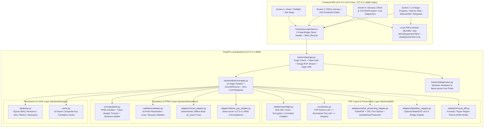

# PaperBridge Local — アーキテクチャ設計書 (ARCHITECTURE.md)

## 1. アーキテクチャ全体像

PaperBridge Local は、**React + TypeScript + PDF.js によるローカル 4 画面フロントエンド**、**PDF 構造・数式・図表保全レイヤー**、および **PLaMo 3 Translate (PFML3) 翻訳推論・検証レイヤー** を疎結合な Adapter パターンで分離したローカル完結型モジュラーモノリス構成を採用しています。

---

## 2. ディレクトリ構成と責務境界

### 2.1 バックエンド (`backend/`)

| パス | 責務 |
|---|---|
| [`backend/config.py`](../backend/config.py) | 環境変数・Windows 日本語/空白パス正規化・ローカルホスト制限・フォント検出・セッション認証トークン管理 |
| [`backend/domain/models.py`](../backend/domain/models.py) | 13 ステージ (`JobStage`)、ブロック状態 (`BlockTranslationStatus`)、保護由来 (`protection_source`)、リビジョン管理 (`edit_revision`, `protection_revision`, `retypeset_revision`) 等のドメインモデル |
| [`backend/pdf/coordinates.py`](../backend/pdf/coordinates.py) | PDF 原生座標 (`Bottom-Left pt`) ⇄ 正規化座標 (`Top-Left pt`, 未回転 CropBox 基準) ⇄ ビューポート座標 (`Top-Left px`, 回転・ズーム適用後) 変換 |
| [`backend/pdf/validation/preflight.py`](../backend/pdf/validation/preflight.py) | 入力 PDF の SHA-256 計算、暗号化・破損・ページ数超過・スキャン PDF 検出、未回転 CropBox 幅・高さ抽出 |
| [`backend/pdf/validation/visual_diff.py`](../backend/pdf/validation/visual_diff.py) | 非翻訳ラウンドトリップおよび翻訳後 PDF の数式・図表領域におけるピクセル差分率・非翻訳背景差分率・ページ全体差分率検証 |
| [`backend/pdf/adapters/native_preserving_adapter.py`](../backend/pdf/adapters/native_preserving_adapter.py) | 外部巨大モデル不要の標準 PDF 再構成アダプタ（`PyMuPDF` + OFL 日本語フォント埋め込み + 数式/図表/表グリッド自動検出 + 手動保護矩形マージ） |
| [`backend/translation/prompts/pfml3.py`](../backend/translation/prompts/pfml3.py) | `PLaMo 3 Translate` 専用 PFML3 フォーマット生成、トークン予算管理、プレースホルダ保護文分割 |
| [`backend/translation/validation/validator.py`](../backend/translation/validation/validator.py) | プレースホルダ欠落・重複・未定義生成・制御トークン残留・反復暴走等の 10 項目検査 |
| [`backend/translation/adapters/mock_adapter.py`](../backend/translation/adapters/mock_adapter.py) | 実機 GGUF なしでも決定論的に全パイプラインと異常系フォールバックを検証可能な Mock アダプタ (`is_mock=True`) |
| [`backend/translation/adapters/llama_cpp_adapter.py`](../backend/translation/adapters/llama_cpp_adapter.py) | ローカル `llama-server` (`127.0.0.1:8000/v1/completions`) と PFML3 生プロンプトで通信する本番推論アダプタ |
| [`backend/storage/cache.py`](../backend/storage/cache.py) | 10 要素複合 SHA-256 キャッシュキーによる SQLite 翻訳キャッシュ |
| [`backend/storage/database.py`](../backend/storage/database.py) | ジョブ状態・ブロック編集（`expected_edit_revision` 競合検出・保存前バリデーション付）・用語集 CRUD・保護領域を永続化する SQLite リポジトリ |
| [`backend/jobs/manager.py`](../backend/jobs/manager.py) | 13 ステージパイプライン実行、リトライ制御、原文フォールバック、途中再開（Resume）、安全停止キャンセル、LLM推論ゼロのアトミック再組版 (`retypeset_job`) |
| [`backend/diagnostics.py`](../backend/diagnostics.py) | Windows OS / CPU / RAM / GPU VRAM / 日本語フォント / `llama-server` 疎通の動的自己診断 |
| [`backend/api/app.py`](../backend/api/app.py) | FastAPI アプリケーション（Origin 検証・`X-PaperBridge-Token` セッション認証・HTTP Range 対応 PDF 配信・ジョブ/保護領域/手動修正/再組版/用語集 API・`frontend/dist` 静的配信） |

### 2.2 フロントエンド (`frontend/`)

| パス | 責務 |
|---|---|
| [`frontend/src/types/api.ts`](../frontend/src/types/api.ts) | [`docs/API_CONTRACT.md`](../docs/API_CONTRACT.md) に完全準拠した TypeScript 型定義・13ステージラベル・保護種別スタイル定義 |
| [`frontend/src/api/client.ts`](../frontend/src/api/client.ts) | `X-PaperBridge-Token` 自動ヘッダ付与、401 時の 1 回自動再ブートストラップ、認証付き PDF `Uint8Array` 取得、成果物 Blob ダウンロード＆`URL.revokeObjectURL` 解放 |
| [`frontend/src/utils/pageRange.ts`](../frontend/src/utils/pageRange.ts) | 1始まりページ範囲文字列（`1, 3-5`）の検証（範囲外・逆順・不正文字・重複除去・昇順正規化） |
| [`frontend/src/utils/coordinates.ts`](../frontend/src/utils/coordinates.ts) | バックエンド正規化座標 (`pt`) ⇄ ビューポート座標 (`px`) 変換（回転 `0/90/180/270°`、倍率 `0.5〜2.5x`、逆方向ドラッグ正規化、最小サイズ判定、ページ境界クランプ） |
| [`frontend/src/utils/glossaryParser.ts`](../frontend/src/utils/glossaryParser.ts) | 用語集 TSV / JSON のクライアント側パーサー（行番号付きエラー報告・重複検出・優先度検証） |
| [`frontend/src/utils/manualEditValidator.ts`](../frontend/src/utils/manualEditValidator.ts) | 手動訳文編集時のリアルタイムプレースホルダ (`{v1}` 等)・引用番号・用語集整合性チェッカー |
| [`frontend/src/components/PdfPageCanvas.tsx`](../frontend/src/components/PdfPageCanvas.tsx) | ローカルバンドル版 `pdfjs-dist` ワーカーによる安全な Canvas 描画（外部 CDN 不使用、PDF 内外部リンク無害化、進行中 RenderTask のキャンセル制御） |
| [`frontend/src/components/Screen1HomePreflight.tsx`](../frontend/src/components/Screen1HomePreflight.tsx) | 画面1：PDF ドラッグ＆ドロップ登録、プリフライト判定表示、ページ範囲・文体・出力形式・推論モード（実機初期値 vs 明示モック）設定 |
| [`frontend/src/components/Screen2ProtectionEditor.tsx`](../frontend/src/components/Screen2ProtectionEditor.tsx) | 画面2：PDF.js + SVG 保護領域エディタ（色だけに頼らない線種＋記号バッジ凡例、自動検出 vs 手動追加 vs 原文維持の区別、ドラッグ追加・削除・保存） |
| [`frontend/src/components/Screen3ProgressReview.tsx`](../frontend/src/components/Screen3ProgressReview.tsx) | 画面3：13ステージ進捗バー、キャンセル要求中 vs 停止済みの区別、中断再開、対訳プレビュー、要確認ジャンプ、モデル出力と分離された手動訳文エディタ、LLMゼロ再組版 (`retypeset`)、成果物ダウンロード |
| [`frontend/src/components/Screen4GlossaryDiagnostics.tsx`](../frontend/src/components/Screen4GlossaryDiagnostics.tsx) | 画面4：用語集 CRUD・TSV/JSON インポート（プレビュー＆行別エラー表示）・エクスポート、およびハードコードなしの動的環境診断・トークンローテーション画面 |

---

## 3. 認証・配信・再組版の安全設計

1. **セッション認証トークン (`X-PaperBridge-Token`)**:
   - クエリ文字列 `?token=...` や URL 埋め込みは `400 Bad Request` で明示拒否し、アクセスログや履歴への漏洩を防止。
   - PDF.js のドキュメント取得も `fetch` ヘッダに `X-PaperBridge-Token` を付与して `Uint8Array` で取得し、認証無効化に頼らず安全に表示。
2. **アトミックな再組版 (`POST /api/jobs/{job_id}/retypeset`)**:
   - 手動訳文編集や保護領域変更後の再組版では **LLM 推論を 0 回** に保証。
   - 一時作業ディレクトリ `working/{job_id}_retypeset_rev{N}/` で組版・Postflight・150 DPI 視覚差分検証を完了し、すべて合格した場合にのみ `outputs/{job_id}/` の成果物を更新（失敗時は直前の正常成果物を完全保持）。

---

## 4. 主要設計判断（ADR 参照）

1. **[ADR-0001: PDF 解析・再構成エンジンの選定と Adapter 境界](adr/0001-pdf-engine-selection.md)**
2. **[ADR-0002: PLaMo 3 Translate 推論基盤と PFML3 プロンプト設計](adr/0002-plamo-inference-and-pfml3.md)**
3. **[ADR-0003: 数式・図表保全、10 項目検証、および視覚差分検査](adr/0003-formula-preservation-and-validation.md)**
